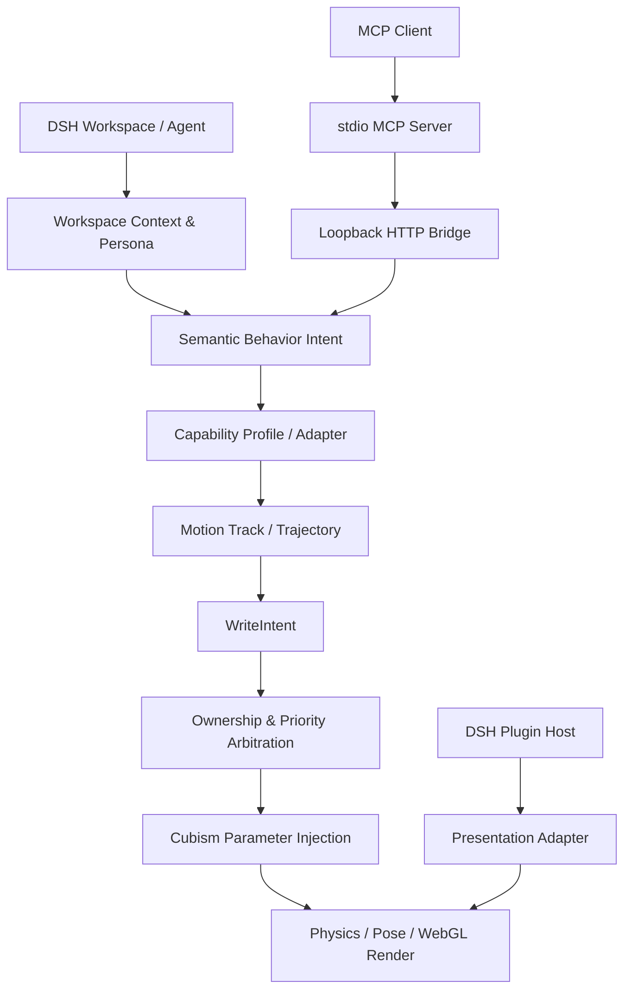

<div align="center">


# DSH-L2D

### Give your DSH workspace a little life.

**面向 DeepSeek Harness 的具身 Live2D 桌宠与 Agent 行为运行时**

让 AI 不只通过文字回应，也能通过视线、表情、姿态与连续动作表达状态。

<p>
  <a href="https://github.com/tequed232/DSH-L2D"></a>
  <a href="https://github.com/tequed232/DSH-L2D"></a>
  <a href="https://github.com/tequed232/DSH-L2D/blob/main/LICENSE"></a>
</p>

<p>
  <a href="#-功能一览">功能</a> ·
  <a href="#-运行架构">架构</a> ·
  <a href="#-快速开始">快速开始</a> ·
  <a href="#-开发与验证">开发</a> ·
  <a href="#-路线图">路线图</a>
</p>

</div>

---

## 🐟 项目简介

DSH-L2D 是一个集成在 **DeepSeek Harness（DSH）** 中的 Live2D 角色系统。它由 DSH 插件宿主、Cubism 渲染器、模型无关的动作核心，以及 MCP Agent 工具接口组成。

它的目标不是简单地“让一个 Live2D 模型动起来”，而是建立一套从 **工作区上下文 → 语义行为意图 → 模型能力适配 → 动作轨迹 → 参数仲裁 → 实际渲染** 的完整链路。

当 Agent 正在思考、执行任务、遇到错误或与用户交流时，角色可以根据上下文做出相应的表情、视线和身体动作。动作由本地确定性运行时执行，模型只负责表达意图，不直接操纵每一帧的底层参数。

> **项目状态说明**：仓库同时包含已落地代码、实验性模块和仍在推进的架构设计。本文会明确标出能力边界；“存在模块”不等于“端到端链路已完成”，设计目标也不代表已通过真实 DSH 环境验收。

## ✨ 功能一览

<table>
<tr>
<td width="50%" valign="top">

### 🎭 Live2D 角色呈现
- Live2D Cubism 5 Web 渲染
- 表情、动作组、姿态与视线控制
- 呼吸、眨眼与待机微动作
- 角色拖拽、缩放和外观交互
- DSH 页面叠加层与桌面宠物窗口路径

</td>
<td width="50%" valign="top">

### 🧠 Agent 具身行为
- AI 工具调用与动作回执
- 情绪、人格和上下文路由
- 多阶段动作链与优先级仲裁
- 工作区状态驱动角色反馈
- 为不同 Live2D 模型适配能力画像

</td>
</tr>
<tr>
<td width="50%" valign="top">

### 🧩 可扩展运行时
- 独立 Core / Renderer / Plugin / MCP 包
- 参数混合与所有权管理
- Cubism 更新阶段调度
- 模型参数扫描与能力注册表
- 本地验收、契约与回归测试工具

</td>
<td width="50%" valign="top">

### 🔒 本地优先与安全边界
- MCP 通过本机回环 HTTP 桥接
- 系统/媒体传感器默认关闭
- 工作区上下文按需聚合与脱敏
- 模型与 Cubism Core 不随仓库分发
- Agent 不直接写入底层 Cubism 对象

</td>
</tr>
</table>

### 当前实现状态

| 子系统 | 状态概述 | 说明 |
|---|---|---|
| DSH 插件入口 | 已有实现 | Node 插件入口、客户端入口和宿主服务桥已存在 |
| Live2D Renderer | 已有实现 | Cubism 模型加载、WebGL 渲染和更新调度代码已存在 |
| Motion Core | 持续完善 | 已有 ParamMixer、ActGate、语义契约、轨迹和画像相关模块 |
| MCP Server | 已有实现 | stdio MCP 工具通过本机插件 HTTP 接口转发 |
| Workspace Agent | 已有实现/迭代 | 有工作区快照、Session 事件和上下文桥接模块 |
| 多容器 Presentation | 部分实现 | overlay 路径有代码与审计记录；其他 Host 容器仍需逐项接线验收 |
| 多模型具身动作 | 持续开发 | 画像和适配基础已存在，复杂动作链的跨模型表现仍需完善 |
| 性能治理 | 规划与迭代 | 需持续验证启动、GPU、帧率、内存和长时间运行表现 |

## 🏗️ 运行架构

<div align="center">


</div>



### 模块职责

| 模块 | 路径 | 核心职责 |
|---|---|---|
| Core | `packages/core` | 语义动作契约、轨迹编译、参数混合、优先级和仲裁 |
| Renderer | `packages/renderer` | Cubism 模型生命周期、WebGL、帧调度和参数注入 |
| DSH Plugin | `packages/dsh-l2d-plugin` | Host 生命周期、客户端注入、工作区桥、设置和窗口 |
| MCP | `packages/dsh-l2d-mcp` | Agent 工具定义、输入校验、动作调用和回执 |
| Tools | `tools/` | 能力扫描、注册表、契约检查和运行时验收 |
| Docs | `docs/` | 架构决策、接口约束、实现指南与 Agent 工作依据 |

### 核心执行链

```text
Agent / Workspace / Persona
          │
          ▼
  Semantic Behavior Intent
          │
          ▼
 Model Capability Resolution
          │
          ▼
  Action Chain / Trajectory
          │
          ▼
      WriteIntent
          │
          ▼
 Priority + Ownership Arbitration
          │
          ▼
  Cubism Parameter Injection
          │
          ▼
     Physics / Pose / Render
```

**重要约束：** Agent 输出的是语义意图，不是逐帧参数。动作必须经过能力检查、轨迹约束、优先级和参数所有权仲裁；未知能力按不支持处理或安全降级。

## 🧠 核心行为系统

### 语义意图，而不是硬编码参数

Agent 可以表达“害羞地低下头并回避视线”这样的行为目标。运行时再根据当前模型的能力画像，把它映射为可用的参数轨迹和资源动作。

### 模型能力画像

每个模型都应拥有自己的能力说明书：

| 能力状态 | 含义 | 执行策略 |
|---|---|---|
| `supported` | 已验证可直接表达 | 正常执行 |
| `approximate` | 可通过近似参数或组合动作表达 | 降级执行并保留标记 |
| `unsupported` | 已确认不具备 | 跳过该能力 |
| `unknown` | 尚未验证 | 不得假定支持 |

### 动作优先级

- `BACKGROUND`：待机、呼吸和环境微动作。
- `NORMAL`：普通交互和情绪表达。
- `FORCE`：需要抢占低优先级行为的动作。

被打断的动作需要有明确终态，并释放其占用的参数所有权。相同骨骼参数的冲突动作不能同时写入。

## 🧩 DSH 集成方式

当前宿主能力以仓库中的 [Host API 审计](docs/Host-API-Audit.md) 为准：

| 宿主位置 | 对应扩展点 | 当前说明 |
|---|---|---|
| 页面悬浮层 | `shell.overlay` | 当前客户端入口已有接入路径 |
| 右侧面板标签 | `sidebar.right.pane.tab` | keyed tab 能力；需独立完成和验收 |
| 设置面板 | `settings.section` | 设置分区，不等于独立设置窗口 |
| 桌面独立窗口 | `pet-window.mjs` | 复用 Electron 窗口通道；需处理独立 WebContents 边界 |

角色的行为状态与展示位置必须分离。切换容器不应重新创建第二个权威 Avatar Runtime，也不应让正在播放的动作从头开始。对于独立 Electron WebContents，必须通过宿主侧状态同步，不得假设 iframe 可以跨窗口共享。

## 🔌 MCP 工具

`packages/dsh-l2d-mcp` 提供 stdio MCP Server，通过本机回环 HTTP 桥接插件服务。

当前工具集合以运行时 `tools/list` 返回为准，README 不把静态工具名列表视为永久 API。MCP 的 `accepted` 回执只代表动作请求已受理；动作是否完成、被打断或仍在等待，应通过动作事件和状态查询确认。

更多配置见 [MCP 包说明](packages/dsh-l2d-mcp/README.md)。

## 🚀 快速开始

### 环境要求

- Node.js 22+
- pnpm 12.5.1（以根目录 `package.json` 的 packageManager 字段为准）
- 已安装的 DeepSeek Harness 环境
- 用户自行准备的 Live2D 模型与 Cubism Core

### 1. 获取代码

```bash
git clone https://github.com/tequed232/DSH-L2D.git
cd DSH-L2D
pnpm install
```

### 2. 构建 Renderer

```bash
pnpm build:renderer
```

### 3. 打包插件

```bash
npm pack ./packages/dsh-l2d-plugin
```

将生成的插件包按 DSH profile 的插件安装方式部署。具体 profile 路径、bundle 注册和 Cordis patch 配置，请以当前 DSH 版本和插件安装说明为准；安装后重启 DSH，使宿主重新收集注入模块。

### 4. 配置模型与 Cubism Core

- 模型目录通过 `DSH_L2D_MODEL_DIR` 或插件当前默认路径提供。
- Cubism Core 文件通过 `DSH_L2D_CORE` 或项目配置指定。
- 不要将模型文件或 Core 二进制提交到仓库或未经许可的 CDN。

## 🛠️ 开发与验证

### 常用命令

| 命令 | 作用 |
|---|---|
| `pnpm build:renderer` | 构建 Cubism Renderer |
| `pnpm test:core` | 运行聚合核心测试 |
| `pnpm test:types` | 类型 smoke 检查 |
| `pnpm test:contract` | Renderer 契约检查 |
| `pnpm scan:capability` | 扫描模型能力 |
| `pnpm gen:ai-tools` | 生成 Agent 工具定义 |
| `pnpm dev:server` | 启动本地调试服务 |
| `pnpm accept -- --read-only` | 对运行中的插件执行只读验收 |
| `pnpm accept` | 完整验收，部分测试会实际驱动角色 |

### 本地调试

```bash
pnpm build:renderer
pnpm dev:server
```

调试服务器会输出本地访问地址。当前开发配置下可使用 `http://127.0.0.1:5300/overlay-test.html` 检查 overlay、动作和参数注入路径。

### 验收注意事项

1. 先确认目标 DSH 插件服务正在运行。
2. 优先使用 `--read-only` 做无副作用检查。
3. 完整验收会触发部分角色动作，不要在 Agent 正在控制角色时并发执行。
4. 单元测试通过不代表真实模型、GPU、Electron 窗口和宿主生命周期已经验收。

## 📁 项目结构

```text
DSH-L2D/
├── apps/
│   └── stage-web/              # 早期 Web 调试壳
├── packages/
│   ├── core/                   # 模型无关的动作与参数核心
│   ├── renderer/               # Live2D Cubism / WebGL Renderer
│   ├── dsh-l2d-plugin/         # DSH 插件宿主与客户端
│   └── dsh-l2d-mcp/            # stdio MCP Server
├── tools/
│   ├── acceptance/             # 运行时验收
│   ├── capability-scan/        # 模型能力扫描
│   ├── w3-registry/             # 能力注册表
│   ├── ownership-spec/         # 参数所有权规格
│   └── dev-server/             # 本地调试服务
└── docs/                       # 架构、规范、审计和 Agent 指南
```

## 🗺️ 路线图

- [ ] 统一插件注册、Renderer 准备、模型加载和 Runtime 激活生命周期。
- [ ] 让所有动作源经过单一参数写入与仲裁链。
- [ ] 完成 sidebar、overlay、桌面窗口的 Presentation Adapter。
- [ ] 建立模型能力画像的扫描、版本化和安全降级闭环。
- [ ] 完善情绪到全身动作链的编排与可观测性。
- [ ] 完善 GPU/CPU 预算、纹理质量、隐藏降频和资源回收。
- [ ] 建立真实 DSH 环境下的长时间运行和回归验收。

## 📚 设计文档

| 文档 | 内容 |
|---|---|
| [具身行为契约](docs/Embodied-Behavior.md) | 语义行为、动作阶段与执行边界 |
| [多模型 Motion Engine](docs/Motion-Engine-多模型架构.md) | 模型无关动作引擎架构 |
| [AIRI 实现指南](docs/MOTION_ENGINE_AIRI_IMPLEMENTATION_GUIDE.md) | 参考实现拆解与落地建议 |
| [能力注册表](docs/W3-Motion-Capability-Registry.md) | 动作能力与模型画像 |
| [Host API 审计](docs/Host-API-Audit.md) | DSH 宿主扩展点与验证记录 |
| [参数所有权不变量](docs/Ownership-Invariants.md) | 参数冲突、所有权和写入约束 |
| [参数读写对照](docs/参数读写对照.md) | Cubism 参数读写边界 |
| [动作链编排](docs/动作链编排-v1.md) | 动作链阶段与编排规则 |
| [性能与多核方案](docs/性能与多核方案.md) | 性能优化设计 |
| [README 编写规范](docs/README-STYLE-GUIDE.md) | 后续 Agent 修改 README 的统一依据 |

## 🔐 资源与许可

本仓库根目录使用 MIT License。第三方 SDK、模型、纹理和动作资源可能受各自独立许可约束。

- Live2D Cubism Core 不随本仓库分发，请从 [Live2D 官方 SDK 页面](https://www.live2d.com/sdk/download/web/) 获取并遵循许可。
- 模型文件不随仓库分发。使用模型前应确认作者署名、授权范围和再分发限制。
- 本机控制服务只应监听 loopback，不应直接暴露到公网。
- 系统/媒体传感器应由用户显式启用；工作区上下文应遵循最小化采集原则。

---

<div align="center">

**Made for DSH · Powered by Live2D Cubism**

如果你正在使用或改进 DSH-L2D，欢迎通过 Issues / Pull Requests 反馈问题与改进建议。

</div>
