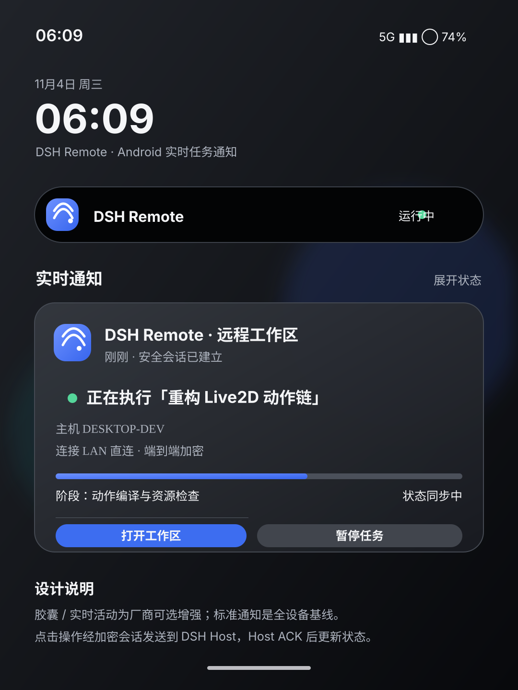

# DSH Go Remote Live2D

### 把 DSH 工作区带到 Android。

**面向 DeepSeek Harness 的 Android 远程工作客户端与 Live2D 具身交互终端**

通过 Kotlin 原生能力连接 DSH 桌面 Host，在手机上继续访问工作区、查看任务状态，并与 Live2D 角色进行自然交互。

  
  
  
  

  <a href="#-项目简介">项目简介</a> ·
  <a href="#-功能一览">功能</a> ·
  <a href="#-运行架构">架构</a> ·
  <a href="#-界面预览">界面预览</a> ·
  <a href="#-开发路线图">路线图</a>

---

## 🐟 项目简介

**DSH Go Remote Live2D** 是面向 Android 的 DSH 远程工作与角色交互客户端。它不是简单的网页套壳，而是以 **Kotlin 原生层 + Jetpack Compose + TypeScript/Web 技术层** 组合构建的移动端工作入口。

项目围绕三个目标展开：

1. **远程工作区**：通过同一局域网直连，或通过云端 ECS 中继建立安全隧道，访问用户自己的 DSH 桌面 Host。
2. **Live2D 具身交互**：在移动端集成 DSH-L2D 的模型呈现与动作运行时，让角色能够根据对话、Agent 状态和工作区事件做出反馈。
3. **DSH 插件兼容**：优先复用原生 DSH 插件协议与工具定义，通过 Android 能力适配层提供摄像头、陀螺仪、语音等受权限管理的设备能力。

> **项目状态说明**：当前仓库以架构、设计规范和参考代码为主。文档中的代码片段用于指导后续实现，不代表已经形成可发布 APK，也不代表远程链路、Live2D 或 OEM 实时通知已完成端到端验收。

## ✨ 功能一览

<table>
<tr>
<td width="50%" valign="top">

### 🖥️ 远程工作区
- Android 访问 DSH 桌面 Host
- 局域网直连与 ECS 中继两种路径
- 文件、终端、任务和会话交互
- 任务状态同步与断线恢复
- 手机端工作区入口与会话管理

</td>
<td width="50%" valign="top">

### 🔐 加密连接
- 客户端—中继—Host 全链路安全传输
- TLS 1.3 传输层保护
- 应用层端到端身份认证与加密
- 中继只转发密文，不持有会话密钥
- 设备配对、密钥轮换与防重放设计

</td>
</tr>
<tr>
<td width="50%" valign="top">

### 🎭 Live2D 角色交互
- 集成 DSH-L2D 角色呈现能力
- 对话、思考、执行与完成状态反馈
- 表情、视线、姿态与动作链控制
- 陀螺仪与摄像头输入（用户授权后）
- 本地渲染与云端工作区并行运行

</td>
<td width="50%" valign="top">

### 🧩 DSH 插件生态
- 兼容原生 DSH 插件协议
- 复用 MCP / Agent 工具定义
- Android Native Capability Adapter
- 插件权限声明与用户授权
- TypeScript Web UI 与 Kotlin 原生能力协作

</td>
</tr>
</table>

### 当前实现状态

| 子系统 | 状态 | 说明 |
|---|---|---|
| 项目架构与模块边界 | 已规划 | Kotlin 原生层、共享 Web 层与 DSH Host 分层 |
| 实时通知设计 | 已编写文档 | 包含状态模型、通知样式和交互规范 |
| Kotlin 通知参考实现 | 已编写示例 | 尚未集成进 Android App，也未完成编译验证 |
| LAN / ECS 中继协议 | 设计阶段 | 必须完成双向认证、端到端加密和重连机制 |
| DSH Host 远程 API | 待实现 | 需审计 DSH Go 服务端接口并定义稳定协议 |
| Live2D Android Renderer | 待验证 | 需评估 Cubism 原生 SDK 与 WebView/Canvas 路径 |
| DSH 插件兼容层 | 待实现 | 需完成插件能力映射、权限模型和兼容性测试 |
| 摄像头 / 陀螺仪 | 规划中 | 默认关闭，按功能显式申请权限 |
| OEM 灵动岛 / 实时活动 | 规划中 | 标准 Android 通知为基线，厂商能力作为增强 |

## 🏗️ 运行架构

~~~mermaid
flowchart TB
    A["Android App · Kotlin / Compose"] --> B["Remote Client"]
    A --> C["Live2D Presentation"]
    A --> D["Native Capability Adapter"]

    B --> E{"连接路径"}
    E -->|"同一局域网"| F["DSH Desktop Host"]
    E -->|"公网 / 异地"| G["ECS Encrypted Relay"]
    G -->|"opaque ciphertext"| F

    F --> H["DSH Go Runtime"]
    H --> I["Workspace / Agent / MCP"]
    I --> J["Native DSH Plugins"]

    C --> K["DSH-L2D Motion Runtime"]
    I -->|"状态事件 / 行为意图"| K
    D -->|"授权后的设备事件"| K
~~~

### 模块职责

| 模块 | 技术选型 | 职责 |
|---|---|---|
| Android App | Kotlin / Jetpack Compose | 页面、导航、生命周期与系统集成 |
| Remote Core | Kotlin | 会话、状态机、重连、权限和任务模型 |
| Secure Transport | Kotlin / OkHttp / Ktor 等待选型 | TLS、设备身份、端到端加密会话 |
| Relay Service | Go | ECS 中继、连接配对、密文转发 |
| DSH Host Adapter | Go / TypeScript | 对接 DSH Go 服务端与现有插件宿主 |
| Live2D Runtime | TypeScript / WebView 或原生 SDK | 角色渲染、动作状态与模型适配 |
| Plugin Bridge | Kotlin + TypeScript | DSH 插件协议映射与 Android 能力桥接 |
| UI Assets | M3E Design 工作流 | 延续 DeepSeek App 风格，补充 Remote / Live2D 专属入口 |

### 安全连接原则

客户端、中继和桌面 Host 之间必须建立经过身份认证的加密连接：

- **局域网模式**：Android 与 Host 在同一可信网络时，可直接建立 TLS 安全会话；仍需设备配对和 Host 身份校验。
- **ECS 中继模式**：Android 与 Host 分别连接中继，由中继转发加密数据流。中继不解密 DSH 应用层消息。
- **端到端保护**：建议在 TLS 之外建立应用层 E2E 会话，使用经过审计的 Noise XX / IK 等握手模式或等价方案。
- **禁止明文回退**：认证失败、证书异常或 E2E 握手失败时必须中止连接，不得静默降级为明文。
- **权限隔离**：远程终端、文件读写、摄像头和麦克风等能力必须分别授权。

## 🎨 界面预览

界面设计遵循 DeepSeek App 的深色视觉语言：保留熟悉的聊天主界面、抽屉导航和输入区域，只在顶部及必要位置增加 Remote、Live2D、工作区状态等专属入口。

### 实时通知 / 灵动岛式任务状态

通知用于呈现远程任务标题、当前阶段、主机连接状态和可执行操作。Android 标准通知为基础实现；ColorOS 等厂商的胶囊、实时活动样式需通过设备适配层单独接入，不能假设所有 Android 设备都支持统一 API。

## 📚 文档

| 文档 | 内容 |
|---|---|
| [实时通知与灵动岛交互规范](docs/LIVE_ACTIVITY_NOTIFICATION.md) | 通知布局、状态机、快捷操作和平台适配 |
| [Android Kotlin 实现指南](docs/ANDROID_IMPLEMENTATION.md) | NotificationCompat、Compose、PendingIntent 与服务示例 |
| [实时通知 SVG 示意图](assets/live-activity-notification.svg) | 可直接预览的界面设计稿 |

## 🧭 开发路线图

| 阶段 | 任务 | 状态 |
|---|---|---|
| R0 | 项目定位、架构边界和 UI 方向 | 已完成文档 |
| R1 | 审计 DSH Go Host API 与插件协议 | 待执行 |
| R2 | Kotlin App 骨架、导航和聊天主界面 | 待实现 |
| R3 | LAN 直连、设备配对与安全会话 | 待实现 |
| R4 | ECS 中继、内网穿透与 E2E 加密 | 待实现 |
| R5 | 远程工作区、终端和文件能力 | 待实现 |
| R6 | Live2D Android 呈现与动作运行时 | 待验证 / 待实现 |
| R7 | DSH 插件兼容层与 Android 能力适配 | 待实现 |
| R8 | 实时通知、快捷操作与 OEM 适配 | 参考代码已编写 |
| R9 | 摄像头、陀螺仪和语音交互 | 待实现 |
| R10 | 安全审计、耗电测试与多设备验收 | 待执行 |

## 🛠️ 技术约定

- Android 核心优先使用 **Kotlin**；UI 使用 Jetpack Compose。
- Go 用于与 DSH Go 架构一致的 Host / Relay 服务端组件。
- TypeScript 用于共享 Web UI、Live2D Web 渲染层及跨端插件协议。
- 不以 WebView 取代所有原生能力；摄像头、传感器、通知、后台任务和安全存储由 Kotlin 管理。
- 不复制一套平行插件生态；优先通过兼容适配层复用 DSH 原生插件协议。
- 远程执行始终发生在用户自己的 DSH Host；ECS Relay 只承担连接桥接，不成为默认执行环境。

## 🔒 隐私与权限

- 摄像头、麦克风、陀螺仪及其他传感器按需启用，默认关闭。
- 不把访问令牌、密钥、终端输出或工作区敏感内容放进通知和 Intent。
- 中继服务不保存应用层明文，不记录可还原用户工作区内容的日志。
- 用户可随时撤销设备配对、插件权限和远程会话。
- 云端工作区与本地工作区必须明确标识，避免用户误判执行位置。

---

**Made for DSH · Powered by Kotlin · Connected securely**

让 DSH 工作区随身可用，让 Live2D 角色成为移动端交互的一部分。

