# 节点编辑器教程

DSH-L2D Motion Graph 是一个单文件节点编辑器（`packages/dsh-l2d-plugin/assets/motion-graph.html`），用来把 Live2D 的动作、表情、姿势、视线编排成一张图，再编译成桌宠可执行的 `segments`。

本文按「先上手，再查节点，最后看 AI 编辑」的顺序写。动图都是用无头浏览器真实操作编辑器录的。

> 录制说明：动图里的红色圆点是录制脚本加的指针标记，只跟随真实的鼠标事件，编辑器本身没有这个元素。录制时没有加载任何 Live2D 模型，顶栏「模型」框里的文字只是示例图的 modelId 字段。

## 打开编辑器

```bash
node tools/dev-server/index.mjs --port 5341
# 浏览器打开 http://127.0.0.1:5341/dsh-l2d/motion-graph.html
```

也可以直接双击打开 `motion-graph.html`。这种情况下没有后端，「AI 编辑」页签会显示「接口未就绪」。

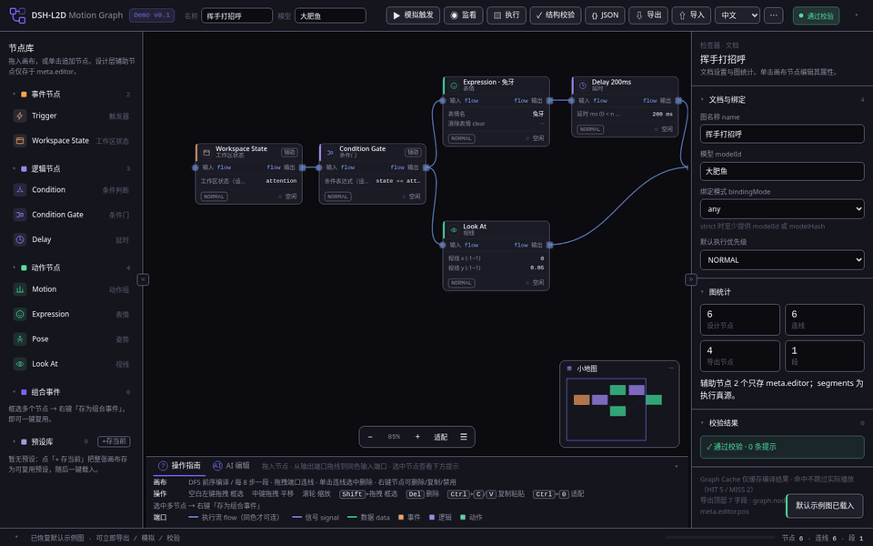

界面分五块：顶栏（文件和执行按钮）、左侧节点库、中间画布、右侧检查器、底部的「操作指南 / AI 编辑」栏。

## 基本操作

### 添加节点

单击节点库里的条目，节点会加在画布可见区域里；也可以把条目拖到画布上的指定位置。


### 连线与断开

从一个节点的输出端口拖到另一个节点的输入端口。只有同色端口能连（执行流 `flow`、信号 `signal`、数据 `data` 三种线型，底栏「端口」行有图例）。单击连线再按 `Del` 断开。


### 编辑参数

选中节点，在右侧检查器里改参数。节点卡片正文会同步显示最多三项关键参数。表情名、动作组只能从白名单里选，不能自由输入，这样导出一定能通过校验。

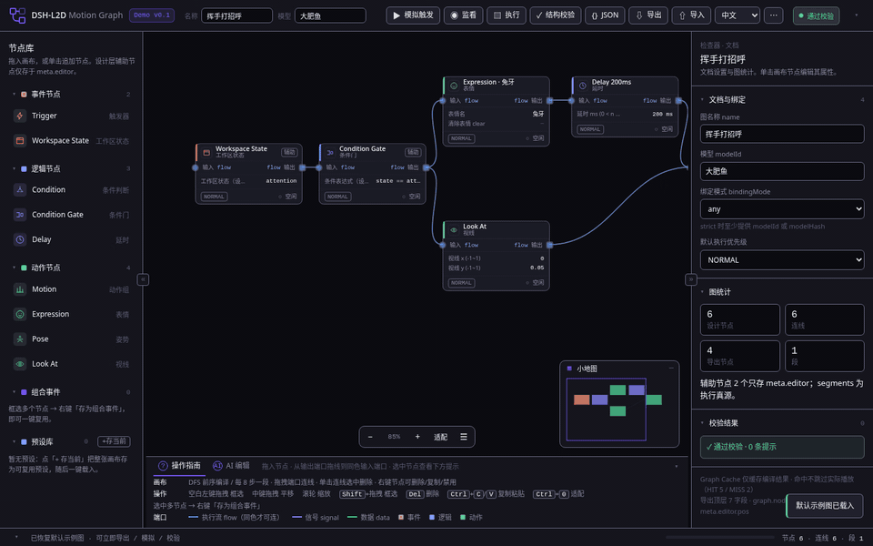

### 选中节点的提示

单选一个节点时，节点正下方会出现这个节点的用途说明和快捷键。点空白处收起。底栏「操作指南」放的是全局操作说明，选中节点的提示只说当前节点。


### 折叠面板

四边都能折叠：顶栏、底栏、状态栏、左侧节点库、右侧检查器，以及节点库分组、检查器卡片、小地图和各浮窗。折叠后仍保留图标和文字（左右两侧变成竖排的小条），折叠状态会记住，下次打开不变。系统设置了「减少动态效果」时不播放折叠动画。

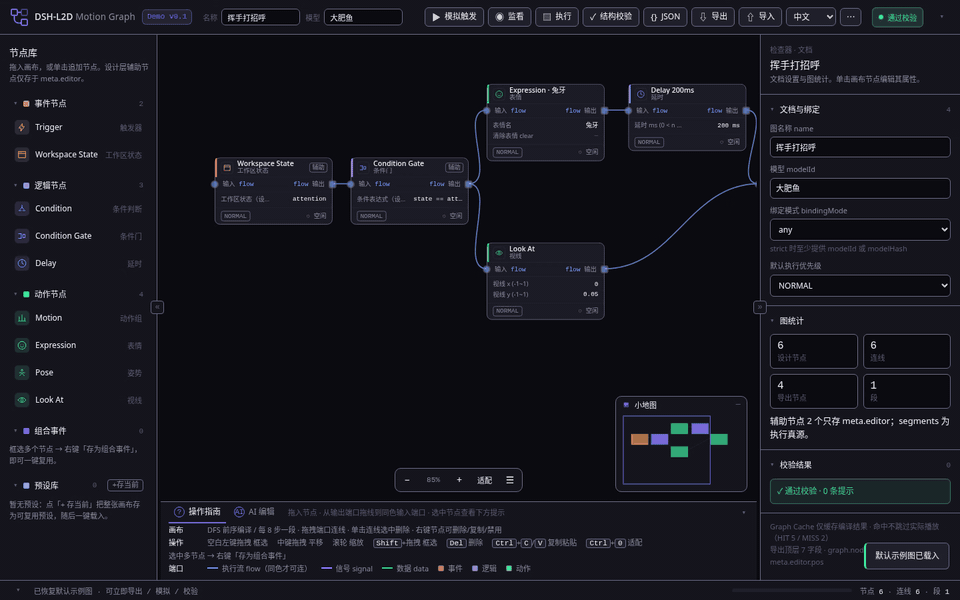

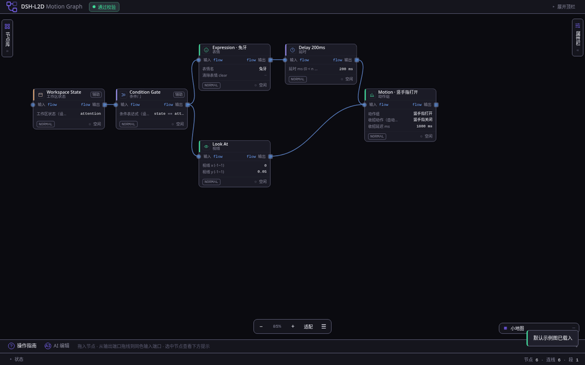

### 切换语言

顶栏语言菜单切换中文、English、日本語。节点 ID、端口 ID、导出字段永远不翻译，三种语言下导出的 JSON 逐字节一致。

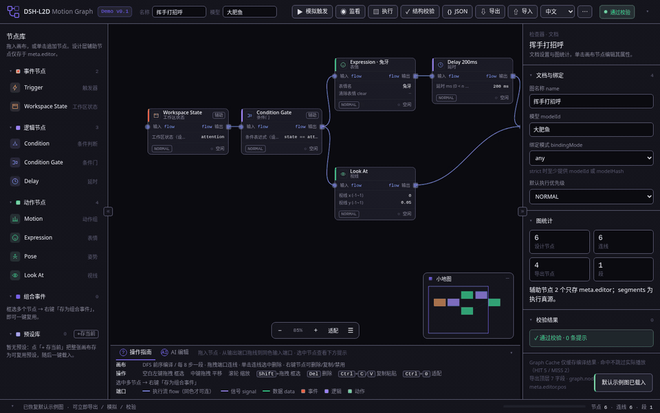

### 校验、编译和查看 JSON

「结构校验」检查环、孤立节点和白名单。「{} JSON」打开导出预览，改参数后预览会实时刷新。「模拟触发」在本地按编译结果逐步播放，不连模型。

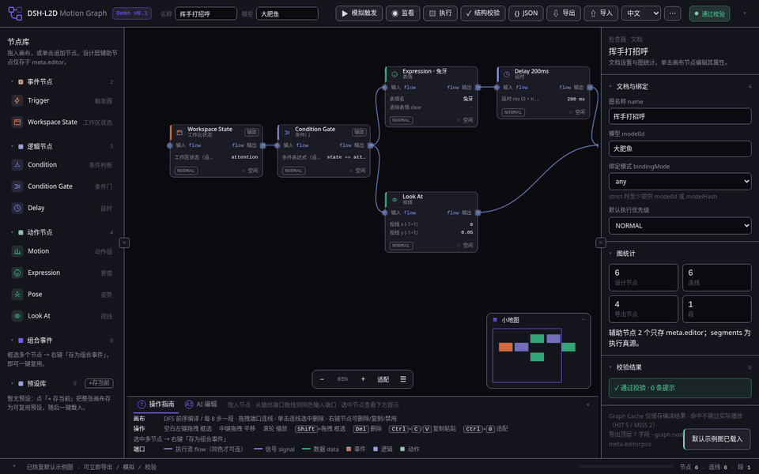

## 节点参考

节点分三组：事件、逻辑、动作。卡片左上角的色条表示分组，标题右侧的标记表示状态：「辅助」是只存在于设计层的节点，「⊘ 已禁用」不参与编译，「▸ 执行中」是模拟时正在播放的节点。状态都配了文字，不单靠颜色区分。

所有节点都有一组通用字段：节点标题、执行优先级（BACKGROUND / NORMAL / FORCE，写进导出段）、冷却时间、执行状态、模型白名单、端口类型、禁用。其中冷却时间、执行状态、模型白名单只是设计层标注，不写进导出的动作字段。

每个节点都按「添加 → 连线 → 改参数 → 模拟」实测过，截图是实测时的画面。

### 事件节点

#### Trigger（触发器）

- 用途：图的事件入口，标注由什么事件触发（例如 `on_poke`）。
- 端口：输出 `flow`。
- 参数：事件名（设计层）。
- 注意：辅助节点，只存进 `meta.editor`，不进 `graph.nodes`，模拟时直接跳到下游动作。

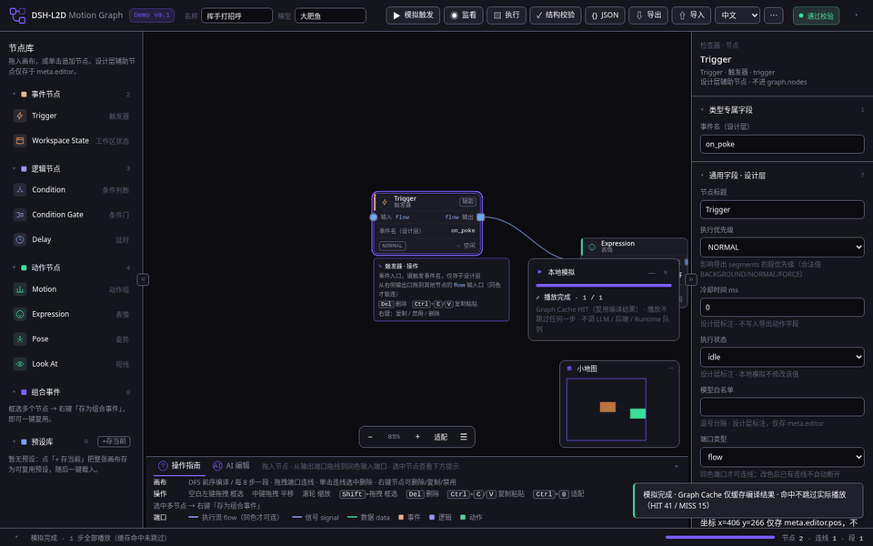

#### Workspace State（工作区状态）

- 用途：按工作区状态（例如 `idle`、`attention`）分支。
- 端口：输入 / 输出 `flow`。
- 参数：工作区状态（设计层）。
- 注意：辅助节点，不参与编译。

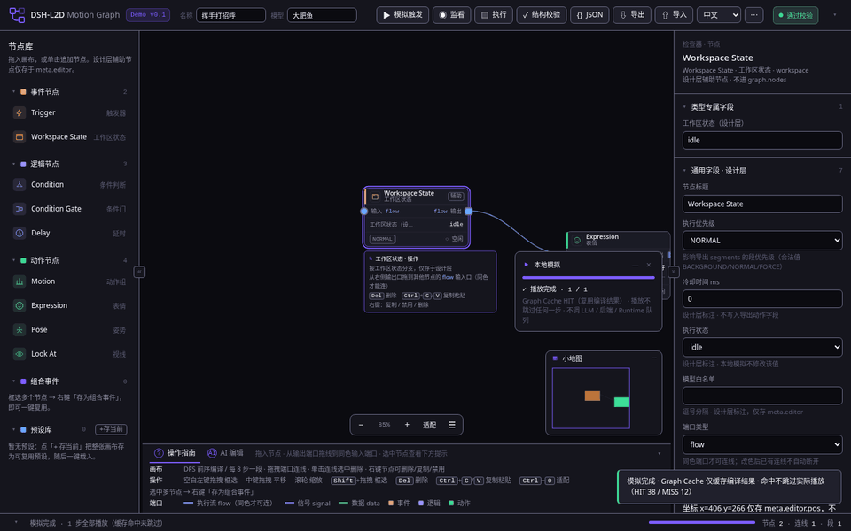

### 逻辑节点

#### Condition（条件判断）

- 用途：写一个判定条件，例如 `idle == true`。
- 参数：判定条件（设计层）。
- 注意：表达式目前只存在设计层，编译和模拟都不计算它，下游动作总会执行。


#### Condition Gate（条件门）

- 用途：用表达式控制是否放行，例如 `state == focus`。
- 参数：条件表达式（设计层）。
- 注意：和 Condition 一样，当前不参与编译和模拟。

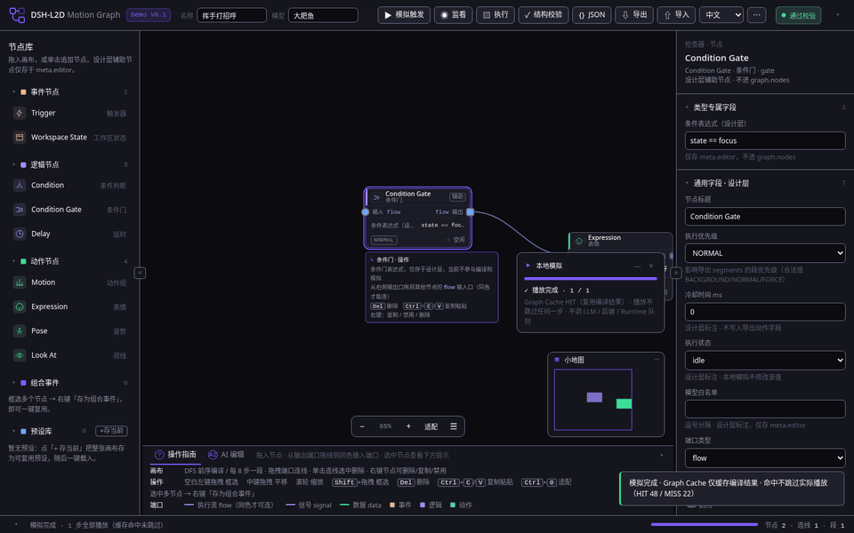

#### Delay（延时）

- 用途：等一段时间再执行下一个动作。
- 参数：延时 ms，范围 1 到 5000。
- 注意：Delay 不是独立的一步。编译时它的时长累加到下一个动作节点的 `delayMs` 上，所以「Delay 450 → 表情」模拟时只显示 1 步。Delay 后面必须接动作节点，否则编译出的 segments 为空，校验会报错。

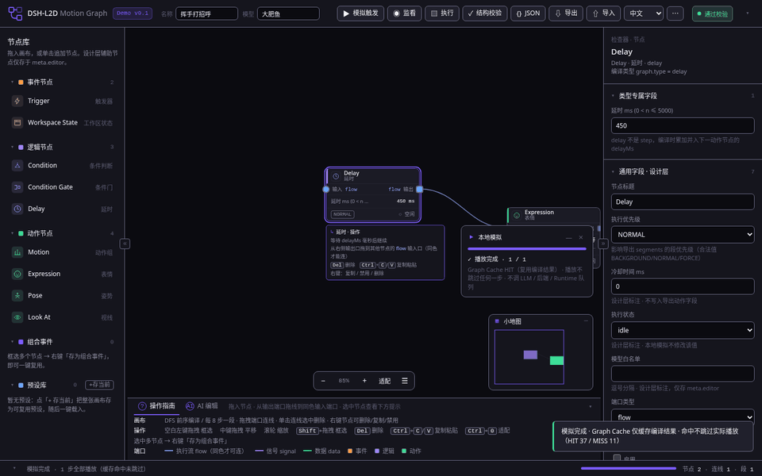

### 动作节点

动作节点会编译成 `segments` 里的一步。它们都有「步前延时 delayMs」，表示这一步开始前等多久。

#### Motion（动作组）

- 用途：播放模型的动作组。
- 参数：动作组（白名单 6 项）、收招动作（按 PAIRED_CLOSES 自动配对，只读）、收招延迟 ms（300 到 12000）、步前延时。
- 示例：选「抚胸手关闭」后接一个表情，模拟为 2 步。

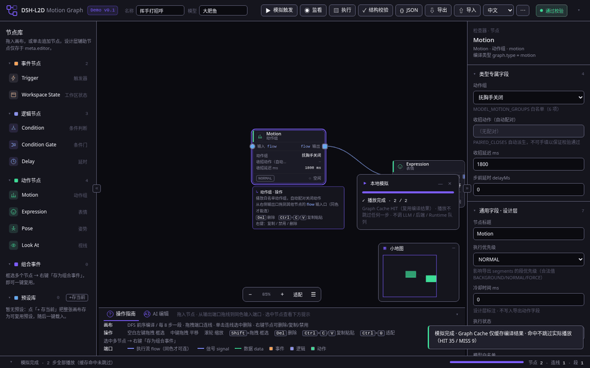

#### Expression（表情）

- 用途：切换表情。
- 参数：表情名（白名单 21 项）、清除表情 clear（先清掉当前表情）、步前延时。

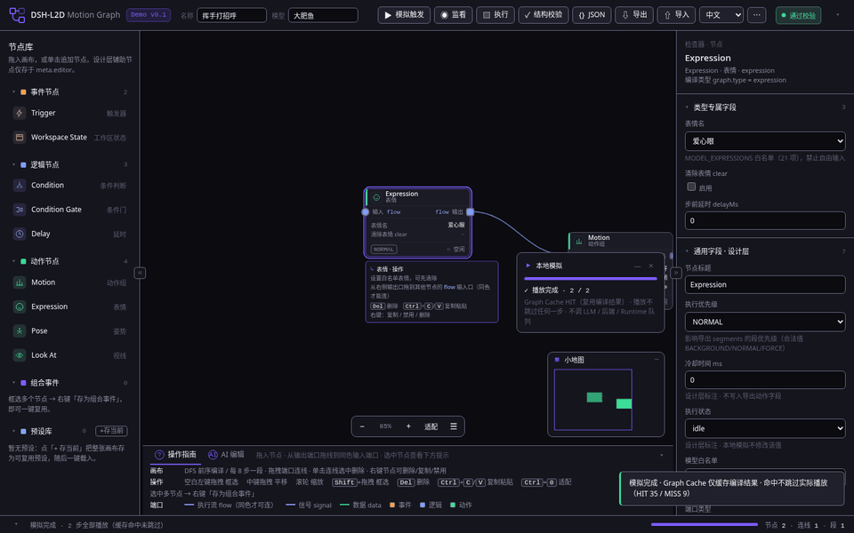

#### Pose（姿势）

- 用途：设置左右手姿势。
- 参数：右手 right、左手 left（留空表示不改）、步前延时。

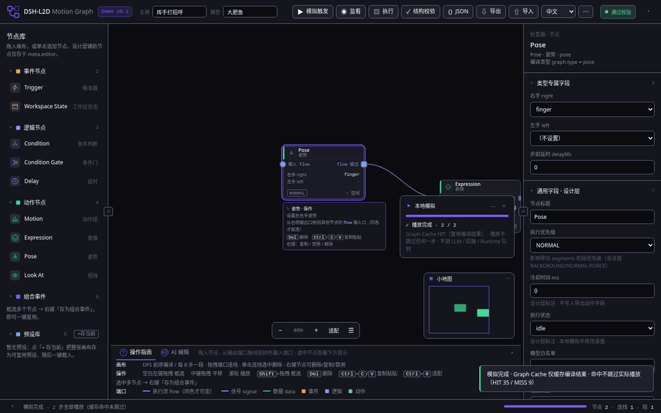

#### Look At（视线）

- 用途：让模型看向某个方向。
- 参数：视线 x、视线 y，范围 −1 到 1；步前延时。

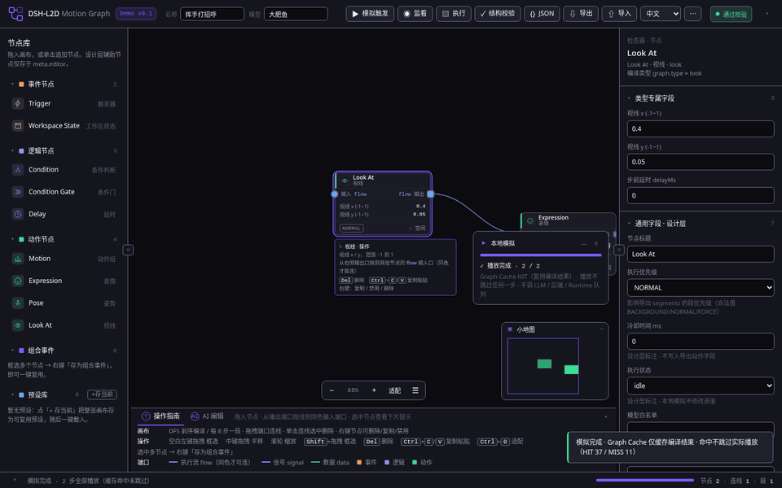

## AI 编辑

底栏切到「AI 编辑」页签，用一句话描述想怎么改这张图。AI 不会直接改画布：它先返回一组修改操作（ops），你看过预览、点「确认应用」后才生效。

流程：

1. 输入一句话，点「生成修改」。编辑器把当前图的设计层（`nodes`、`edges`、`viewport`）、你的指令和界面语言发给后端 `ai-edit`。
2. 预览区逐条用人话列出每项修改，例如「添加表情节点「脸红」」「连接 Look At → 脸红」。画布上会被改动的节点显示虚线框和「AI」标记。
3. 点「确认应用」，编辑器把 ops 和 `baseHash` 发给后端 `apply-ops`。后端校验通过后返回新图，编辑器用它替换画布。
4. 不满意就点「撤销这次 AI 修改」，画布恢复到应用前的样子。

几种情况的显示：

| 情况 | 显示 |
| --- | --- |
| 打开的是本地文件，或后端没有这个接口 | 接口未就绪 |
| 后端没配置 AI（503 `ai-unavailable`） | AI 未配置或暂不可用，未生成任何改动 |
| AI 调用失败（502 `ai-failed` / `ai-bad-response`） | 生成失败，可点「重试」 |
| 生成后你又改了画布，或后端返回 409 `stale-graph` | 画布已变化，请重新生成 |
| 校验不通过（`valid=false`） | 不应用；错误显示在对应那一条修改下面，带中文说明和原始错误码 |
| 有提示（如 `live2d-id-not-in-model`） | 只提示，不阻止应用 |

编辑器自己不计算图的 hash，也不在本地执行 ops，应用和校验都以后端为准。

没有配置 AI 时的真实画面（后端返回 503）：


确认、撤销、画布变化后过期、校验失败：


> 这段动图录制时没有 AI Key，`ai-edit` 的回包是录制脚本拦截后填入的一组手写 ops（预览里也写明「录制脚本注入的手写 ops，非 AI 生成」），`baseHash` 取自真实后端的回包。`apply-ops` 走的是真实后端：确认应用、撤销、校验失败（不存在的表情 `unknown-live2d-id`）都是后端的真实结果。

### 给开发者

- 接口契约：[AI-EDIT-API.md](AI-EDIT-API.md)
- 节点与 op 的机器可读定义：[NODE-SCHEMA.json](NODE-SCHEMA.json)
- Live2D 可用 ID 目录：[LIVE2D-CATALOG.md](LIVE2D-CATALOG.md)
- Live2D 合法 ID 说明：（由 Live2D领域大蛇 编写，链接待补）
- MCP 工具：`l2d_graph_get` 读取已导入图的设计层和 hash；`l2d_graph_apply_ops` 按 `baseHash` 整批应用 ops，校验通过才写回。
- 前端适配层：`packages/dsh-l2d-plugin/editor-src/modules/ai-edit.js` 里的 `AiEditAdapter`。所有请求都经过它，换后端地址或格式只改这一处。

以上三个文档随 #52 合入；在 #52 合入前，这几个链接在本分支上打不开。
